# User Guide

## Before you start

If you have problems with the GPS receiver (no fix) or with the sensors
(e.g. the compass points the wrong way), check the [FAQ](faq.md) first. It
covers the most common problems and many use cases.

Features marked **[PRO]** need the PRO version of the app. Features marked
**[Android]** are not available on iPhone and iPad, because iOS does not give
apps access to the GNSS receiver or to some of the sensors.

## What does it do?

**GPS Status & Toolbox** shows all the GPS and sensor data of your phone. It is
designed to be simple, yet effective. It lets you see what is happening while
the GPS is looking for your location, and it doubles as a compass and a
spirit level. It measures the phone's speed and acceleration, and the
brightness and air pressure if your phone has the sensors for them. It also
has basic navigation features that are useful when you are out in the wild.

The app has three main screens. Swipe left and right to move between them, or
pick one from the side menu:

- **Status** - all your raw GPS and sensor data
- **Radar** - basic off-road navigation to a target
- **Locations** - your saved locations (POIs)

The side menu also has the calibration tools, the diagnostic screens and the
**Settings**.

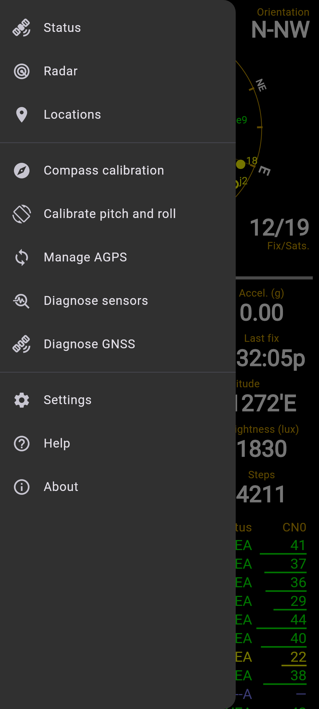

!!! tip
    By default the toolbar is hidden to leave more room for the data. Tap the
    screen to show it; it hides again after a few seconds. You can change this
    in *Settings / Toolbar*.

!!! tip
    Long-tap almost any value on the Status and Radar screens to change its
    unit or format, or to reach the settings that belong to it. See
    [Configuring an instrument](#configuring-an-instrument).

## Status screen

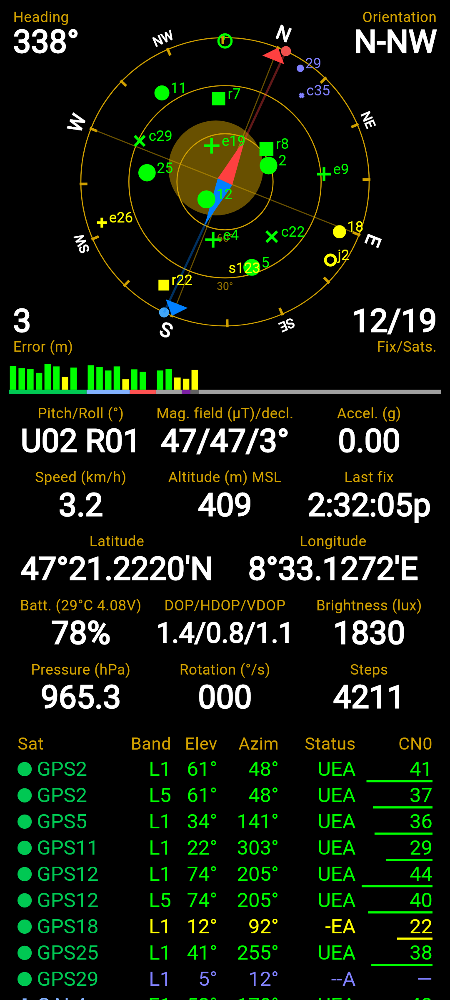

The screen has three main parts: the **sky chart**, the **signal strength
bars** with the **satellite list**, and the **instrument panels**.

### Sky chart

The sky chart shows the satellites above you as your phone's receiver
detects them. The center of the chart is straight above you (the zenith), the
rings mark 60° and 30° elevation, and the outer circle is the horizon. The
chart turns with your phone, so its top always points where the top of your
phone points.

The shape of a symbol, and the letter in front of its number, tell you which
constellation the satellite belongs to:

| Constellation | Symbol | Label |
|---|---|---|
| GPS (USA) | disk | `5` |
| GLONASS (Russia) | square | `r7` |
| Galileo (EU) | plus (+) | `e19` |
| BeiDou (China) | cross (x) | `c22` |
| QZSS (Japan) | ring | `j2` |
| NavIC (India) | disk | `7` |
| SBAS (correction satellites) | label only | `s123` |

The bigger the symbol, the stronger the signal from that satellite. On
Android the color shows what data the phone has for the satellite and whether
it uses it:

- green: the satellite is used to determine your location
- yellow: all orbital data (ephemeris) is available, but the satellite is not used
- blue: only rough orbital data (almanac) is available
- gray: no orbital data is available

On iPhone the app cannot read the GNSS receiver. Instead, it calculates
where the satellites are from their published orbits (see *Satellite data
source* under [Settings](#data-sources)), so the symbols are colored by
constellation and have no signal strength.

A fix usually needs at least 4 satellites. The more satellites are used, the
more accurate the position, up to a point: 20 satellites are not much better
than 10. Long-tap the chart to choose which constellations it shows.

The compass needle in the center shows the direction of the magnetic field
as your phone measures it. This is not always magnetic north: anything
magnetic nearby bends the field. Buildings and vehicles always disturb it, so
do **NOT** expect the compass to be reliable there. The app calculates the
magnetic declination (the angle between magnetic and true north) and the
expected strength of the magnetic field at your location. If the measured
field is stronger than expected, the needle grows; if it is weaker, the
needle shrinks. With no disturbance around you, the needle is roughly the
size of the inner circle.

If the needle turns transparent, or a question mark appears in the magnetic
field instrument, the compass needs recalibrating. See
[Calibration](#calibration).

Magnetic compasses are inherently inaccurate; GPS is much better at telling
which way you are moving. Once you move faster than 5 km/h, a triangle on the
rim shows your direction of travel and the chart aligns itself to the far
more accurate GPS heading (the *Heading* corner then reads *Heading (GPS)*).
You can turn this off in *Settings / Lock to GPS speed*. The red and blue
arrows on the rim show true north and south; the dots show magnetic north and
south.

When the phone rotates, a green arc along the rim shows how fast: the
longer the arc, the faster it turns.

The moving amber circle is a spirit level: lay your phone on a surface, and
the surface is level when the bubble is centered. You may need to calibrate
it first (*Calibrate pitch and roll* in the side menu).

!!! tip
    The small empty circle (the *pitch indicator*) helps you find any
    satellite in the sky. Turn and tilt your phone until the circle covers a
    satellite symbol: the top of your phone now points at the real
    satellite, some 20,000 km away. (Not particularly useful, but extremely
    geeky!) You can turn off both the bubble and the circle in Settings.

The four corners of the chart show:

- **Heading**: the direction the phone is facing (or, when moving, the
  direction of movement).
- **Orientation**: the main cardinal point the phone is facing.
- **Error**: the accuracy of the current location. Before the first fix it
  shows the **AGPS age** instead: the age of the assistance data that helps
  the receiver get a fix quickly **[Android]**.
- **Fix/Sats.**: the number of satellites used in the fix / the number of
  satellites in view.

### Signal strength bars and satellite list

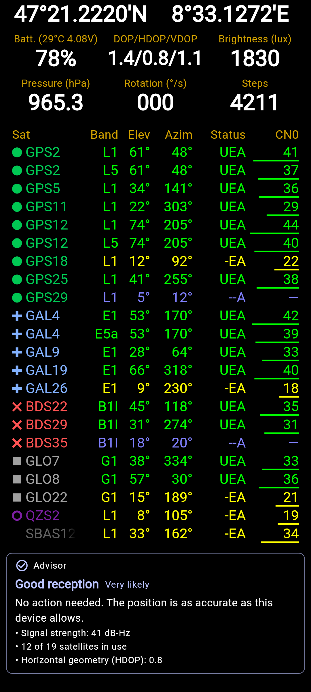

**[Android]** Below the chart, each bar shows the strength (CN0, in dB-Hz)
of one satellite signal, in the same color as the satellite's symbol. The
thin line under the bars is colored by constellation, so you can see at a
glance how many signals each system contributes.

Scroll down for the **satellite list**: one row per satellite signal, sorted
by constellation and number. Modern phones receive many satellites on two
frequency bands (e.g. GPS L1 and L5), and each band gets its own row.

- **Sat**: constellation and satellite number
- **Band**: the frequency band of the signal (only on phones that report it)
- **Elev** / **Azim**: elevation above the horizon and compass direction of
  the satellite
- **Status**: **U** = used in the fix, **E** = ephemeris available, **A** =
  almanac available
- **CN0**: signal strength in dB-Hz, also shown as a bar

You can turn off the list in *Settings / Show satellite list*.

### Instruments

The rest of the screen shows values from the phone's sensors and the GPS.

- **Pitch/Roll**: the attitude of your phone (U/D = up/down, L/R = left/right).
- **Mag. field / decl.**: the measured strength of the magnetic field / the
  expected strength at your location / the magnetic declination (the last two
  **[Android]**). The first slash turns into a question mark when the compass
  needs recalibration.
- **Accel.**: the measured acceleration of the phone.
- **Speed**: the speed measured by the GPS.
- **Altitude**: the current altitude above Mean Sea Level (MSL) or the WGS84
  ellipsoid (*Settings / Mean Sea Level altitude*). You can add a fixed
  correction in *Settings / Altitude correction*.
- **Last fix**: the time of the fix on the screen, in local time or UTC.
- **Latitude / Longitude**: your location, in the format chosen in Settings.
- **Batt.**: the remaining charge, with the battery temperature and voltage
  **[Android]**.
- **DOP/HDOP/VDOP** **[Android]**: the dilution of precision, which tells how
  well the satellites are spread across the sky (smaller is better), as a
  total and split into horizontal and vertical.
- **Brightness** **[Android]**: the measured light level, if your phone has a
  light sensor.
- **Pressure** **[PRO]** **[Android]**: the air pressure, with an arrow showing
  whether it is rising or falling (if your phone has a barometer).
- **Rotation** **[PRO]**: how fast the phone turns, from its gyroscope.
- **Steps** **[PRO]** **[Android]**: steps counted since the last reset.
- **Humidity, Dewpoint, Humidex, Temperature** **[PRO]** **[Android]**: only on
  the few phones that have humidity or temperature sensors.

Tall screens always show the battery, DOP and brightness row; smaller
screens show it only in PRO. The PRO rows below it appear only on tall
screens.

While the receiver is looking for your location, *Looking for GPS location…*
takes the place of the GPS instruments.

### Configuring an instrument

Long-tap an instrument to configure it on the spot, without a trip to
Settings. This works on the Status screen, in the corners of the sky chart and
on the Radar screen. Most instruments let you pick their unit or format
(speed, distance, altitude, coordinates, heading, pressure, temperature,
brightness, rotation). Some offer more:

- **Altitude**: sea level or ellipsoid altitude, and the altitude correction.
- **Pitch/Roll**: the unit, pitch and roll calibration, and sensor filtering.
- **Mag. field / decl.**: compass calibration and sensor filtering.
- **Accel.**: whether a phone at rest reads 0 g or 1 g.
- **Last fix**: local time or UTC.
- **Steps**: reset the step counter.

The copy button in the dialog's title copies the current value to the
clipboard.

### Advisor [PRO] [Android]

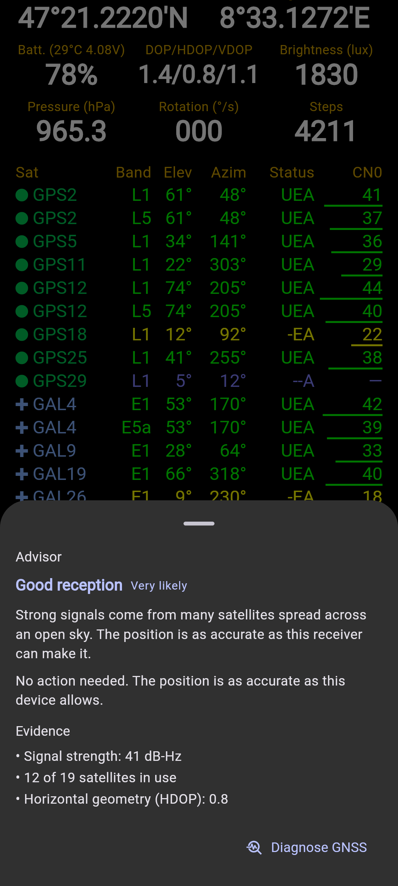

The **Advisor** card at the bottom of the Status screen sums up your GNSS
reception in plain words, so you don't have to interpret the raw numbers
yourself. It tells you, for example, whether you have *Good reception*, are
*Indoors or heavily obstructed* or in an *Urban canyon*, or suffer from
*Strong multipath* or *Poor satellite geometry*, and how sure it is. It also
warns about a *Mock location provider* and about *Possible spoofing* or
*Possible jamming or interference*.

Tap the card to see the explanation and the measurements behind the
verdict. You can turn the Advisor off in *Settings / Advisor*.

## Radar screen

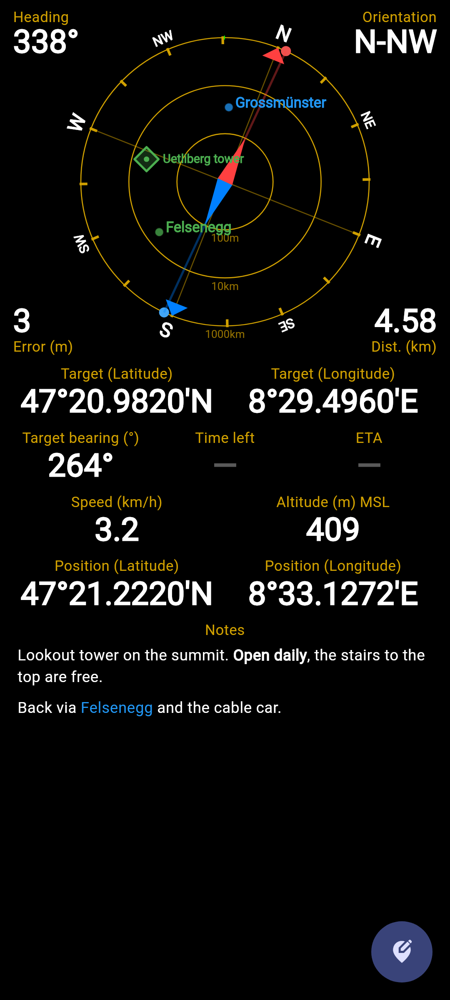

The Radar screen guides you to a target using the GPS and the compass:
just walk towards the point, using the screen like a radar. It shows the
direction of and distance to the target, and the circle around the center
shows the accuracy of your position. The rings are logarithmic, so both
nearby and distant points fit on the screen.

The target is a diamond with its name. Other saved locations appear as small
dots if you make them visible on the Locations screen (tap the eye icon).

- **Heading** / **Orientation** / **Error**: the same as on the Status screen.
- **Dist.**: the distance to the target.
- **Target (Latitude / Longitude)**: the coordinates of the target.
- **Target bearing**: the compass direction to the target.
- **Time left** / **ETA**: how long it takes to reach the target at your
  current speed, and when you will arrive. They appear once you move towards
  the target faster than 5 km/h.
- **Speed** / **Altitude**: the same as on the Status screen.
- **Position (Latitude / Longitude)**: your current location.
- **Notes**: the target's notes, if it has any. Tap a link in them to open a
  web page or another location.

As on the Status screen, long-tap a value to change its unit or format.

Use **Show on Map** in the toolbar to open the target (or your current
location, if there is no target) in your map app.

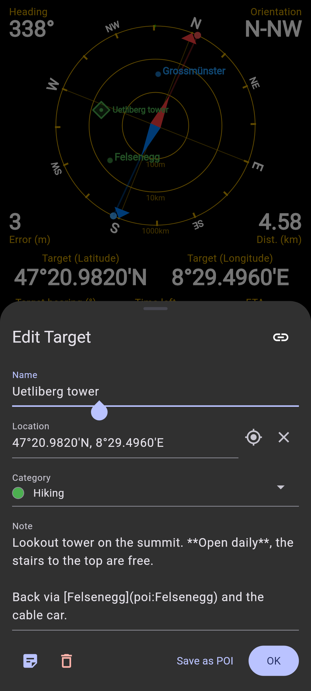

Tap the round button at the bottom right to edit the target: change its
name, enter coordinates in any supported format, pick a category and write
notes. **Save as POI** saves the target to the Locations screen. If there is
no target yet, the button creates one from your current location.

!!! tip
    Long-tap the button to make your current location the target at once,
    without a dialog. It replaces the previous target. Use it to drop a
    breadcrumb you can find your way back to later, e.g. where you parked
    your car.

## Locations

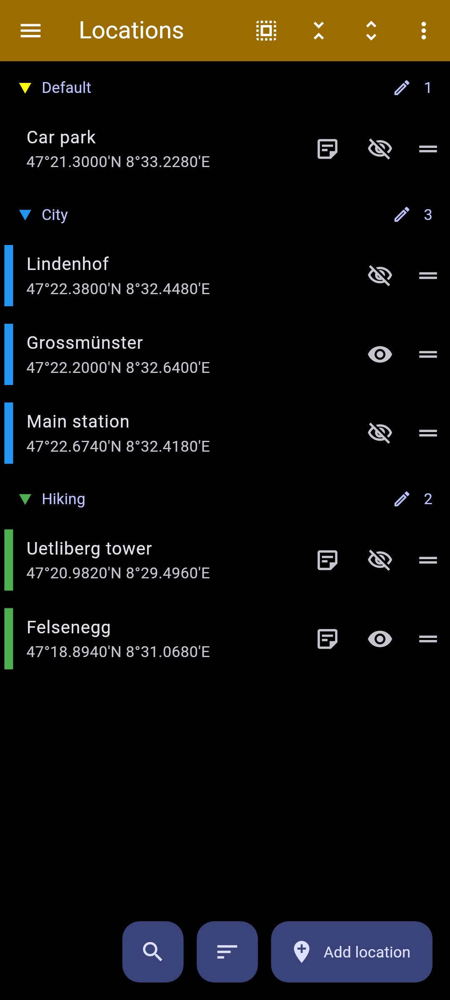

This screen holds your saved locations (POIs). The free version saves up to
3; **[PRO]** has no limit.

- Tap **Add location** to add one. *Mark location* in the dialog fills in your
  current position.
- Tap a location to edit it.
- Swipe a location to the left to make it the radar target and switch to the
  Radar screen.
- Tap the eye icon to show or hide the location on the radar.
- Tap the note icon to read a location's notes without opening it.
- Drag the handle on the right to reorder the list.
- Long-tap a location to select it. You can then select more, and move them
  to a category, show or hide them on the radar, share them or delete them.

Locations are grouped into **categories**, each with its own color. Tap a
group header to collapse it, or its pencil icon to rename or recolor the
category. *Categories* in the menu manages all of them.

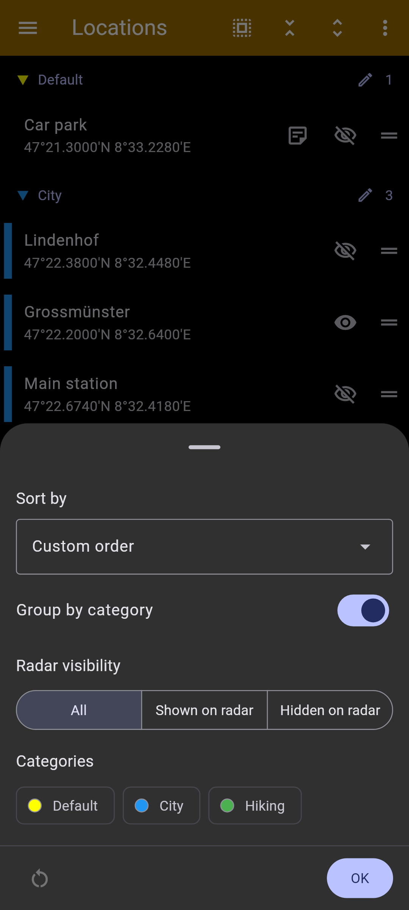

The search button finds a location by its name or notes. The **Filter and
sort** button sorts the list (custom order, name, distance or date), turns
grouping by category on or off, and can limit the list to some categories or
to the locations visible on the radar.

### Notes

Each location can have notes, written in Markdown, so you can use **bold**,
*italic*, lists and links. A `poi:Name` link opens another location, e.g.
`[Felsenegg](poi:Felsenegg)`.

### Import, export and sharing [PRO]

Use *Import* in the menu to load locations from a **GPX**, **KML**, **CSV** or
**GeoJSON** file. You can also open such a file from another app (e.g. a file
manager or an e-mail attachment) with GPS Status.

*Share* in the menu (or in the selection toolbar) exports locations in any of
these formats, as a file or as text.

In the edit dialog, *Copy as URL* copies a location as a `geo:` link (for map
apps), a Google Maps link, or a `poi:` link to paste into the notes of another
location.

## Sharing your position

Tap the share button in the toolbar of the Status or Radar screen to send your
current position to someone. The message comes from a template you can edit
in *Settings / Sharing template*. Placeholders such as `%loc%`, `%altitude%`,
`%speed%` or `%url%` (a map link) are filled in with the current values; the
editor lists all of them. A `%gpsstatus-url%` link opens the position as a
target on the recipient's Radar screen if they have GPS Status, or on a map
in their browser if they don't.

## Calibration

**Compass calibration** (side menu): rotate your phone once or twice around
each of its three axes, then tap OK. You can also just wave it in a figure-8
pattern; try both and see which works better on your phone. The bar in the
dialog shows the accuracy the phone reports, going from red through yellow
to green. You can recalibrate at any time while the app is running; the
dialog only gives you feedback.

**Calibrate pitch and roll** (side menu): lay the phone on a surface you know
is level and tap *Calibrate*. For a more precise result, turn the phone
around by 180° on the same surface and tap *Average*: this cancels out any
tilt of the surface itself. *Reset* removes the calibration.

## Sensor diagnostics

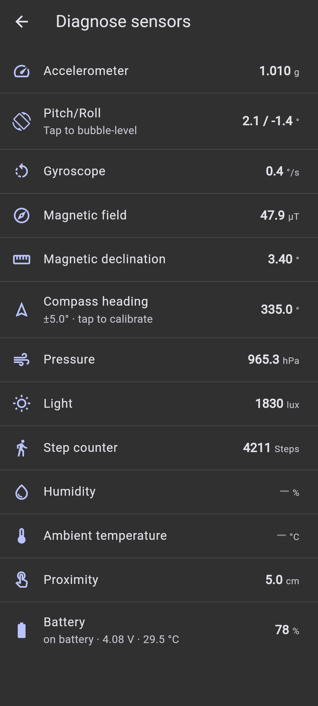

*Diagnose sensors* in the side menu lists every sensor the app uses, with its
current reading. A sensor your phone does not have shows a dash. Use it to
check that a sensor works at all before you look for other causes. Tap
*Pitch/Roll* or *Compass heading* to calibrate them. On iPhone, apps can only
read the motion sensors, the compass and the battery level.

## GNSS diagnostics [Android]

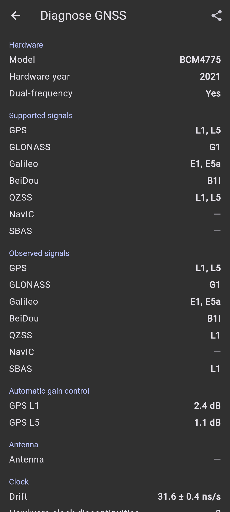

*Diagnose GNSS* in the side menu shows what the GNSS receiver of your phone
reports about itself:

- **Hardware**: the receiver model, its year, and whether it is
  dual-frequency.
- **Supported signals** and **Observed signals**: the bands the receiver
  says it supports for each constellation, and the ones it actually tracks.
- **Automatic gain control**: how much the receiver amplifies each band. A
  sudden change can point to interference.
- **Antenna**, **Clock**, **Raw measurements** and **Capabilities**: details
  for those who process raw GNSS measurements.

The share button sends the report, e.g. with a support request.

## A-GPS [Android]

The GPS receiver gets a fix much faster if it knows in advance where the
satellites are. This assistance data (A-GPS or XTRA) comes from the
internet. GPS Status downloads it automatically when it gets out of date
(*Settings / Auto-download AGPS data*), and the **AGPS age** in the corner of
the Status screen shows how old it is.

*Manage AGPS* in the side menu gives you more control:

- **Delete aiding data**: clears everything the receiver remembers, so the
  next fix is a cold start. Try this when the GPS misbehaves.
- **Force XTRA injection**: downloads fresh assistance data now.
- **Force time injection**: sets the receiver's clock from the network.

## Picture in Picture and background use [Android]

**[PRO]** When you leave the app with the Home button, GPS Status keeps
running in a small Picture in Picture window, so you can keep an eye on the
fix while you use another app. The window shows the Radar if you came from
the Radar or Locations screen, and the Status screen otherwise. Turn it off
in *Settings / Picture in Picture*.

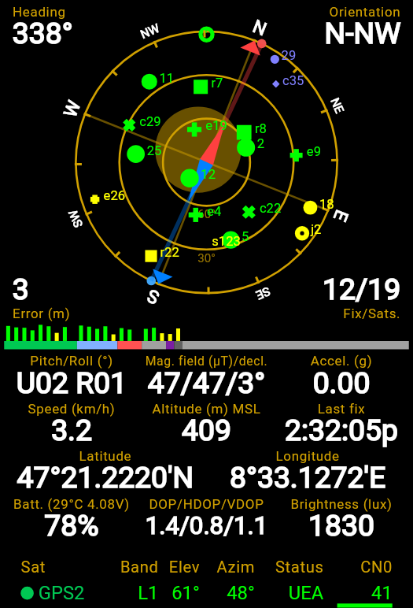

To save battery, GPS Status stops using the GPS when the screen turns off.
Turn on *Settings / Use GPS when screen is off* to keep it running.

## Home-screen widgets and shortcuts [Android]

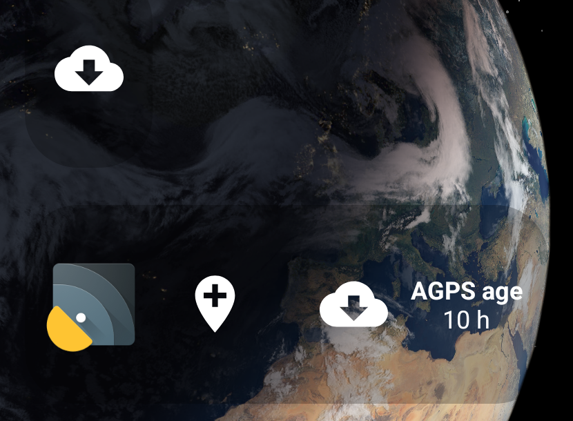

GPS Status has two home-screen widgets:

- **GPS Status** (bottom): buttons to open the app, save your current
  location and update the A-GPS data, next to the age of that data.
- **Update AGPS** (top): a single button that downloads fresh A-GPS data.

Long-tap the app icon for shortcuts to the **Radar**, **Save location** and
**Update A-GPS**. With *Settings / Show Radar in launcher*, the Radar also
gets its own icon in the app drawer.

## App updates [Android]

When Google Play has a newer version, GPS Status offers it right in the app.
The update downloads in the background while you keep using the app; when it
is ready, tap **Restart** to install it. If you tap *No thanks*, the app asks
again after a week, or as soon as an even newer version comes out.

## Settings

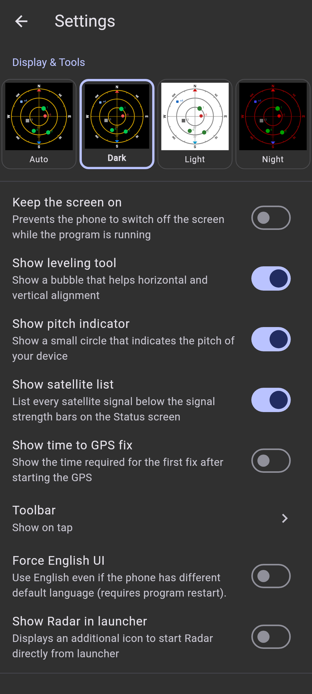

Tap the gear icon in the toolbar, or *Settings* in the side menu. You can
also reach many settings by long-tapping an instrument (see
[Configuring an instrument](#configuring-an-instrument)). GPS Status always
uses the WGS84 datum for coordinates.

### Display & Tools

- **Theme**: *Dark*, *Light*, *Night* (red, to protect your night vision) or
  *Auto*, which follows the system's dark mode and switches to Night when the
  light sensor says it is dark.
- **Keep the screen on** while the app is running.
- **Show leveling tool**, **Show pitch indicator**, **Show satellite list**:
  turn these parts of the Status screen on or off.
- **Show time to GPS fix**: shows how long the first fix took.
- **Toolbar**: always shown, shown on tap, or never (tapping the screen then
  opens the side menu).
- **App language** (or **Force English UI** on older Android versions).
- **Show Radar in launcher** **[Android]**.

### Data sources

- **Satellite data source** **[Android]**: *Live satellites* come from the
  GNSS receiver. *Predicted satellites* are calculated from published orbits,
  as on iPhone.
- **Full GNSS tracking** **[Android]**: turns off the receiver's power saving
  for more accurate measurements, at the cost of battery. Only shown on phones
  that support it.
- **Advisor** **[PRO]** **[Android]**.
- **Location source** **[Android]**: *GPS (device only)* or *Fused (Google)*,
  which also uses Wi-Fi and cell towers.
- **Satellite constellations**: which constellations are shown.

### Units & Formatting

Location format (decimal degrees, degrees and minutes, degrees, minutes and
seconds, UTM, MGRS, Swiss CH1903, British OS Grid, Maidenhead, Plus Code), and
the units of speed, distance, altitude, pressure, temperature, heading, roll
and pitch, angular speed and brightness. **Show UTC time** shows times in UTC
instead of local time. **Sharing template** edits the message used to
[share your position](#sharing-your-position).

### GPS & Sensors

- **Mean Sea Level altitude** **[Android]**: shows altitude above sea level
  instead of above the WGS84 ellipsoid.
- **Altitude correction**: an offset added to the displayed altitude.
- **Reset step counter**.
- **Lock to GPS speed**: aligns the charts to the GPS heading above 5 km/h.
- **Zero based acceleration**: shows a phone at rest as 0 g instead of 1 g.
- **Sensor filtering**: smooths the sensor readings (none, weak, medium or
  strong).

### Diagnostics

**NMEA logging** **[Android]** records the receiver's raw NMEA sentences to a
file you can share. The calibration and diagnostic tools from the side menu
are here too.

### Background behavior [Android]

**Picture in Picture** and **Use GPS when screen is off**, see
[above](#picture-in-picture-and-background-use-android).

### A-GPS [Android]

**Auto-download AGPS data** sets how old the data can get before the app
downloads it again. **Force A-GPS update** and **Reset GPS (delete aiding
data)** do the same as in *Manage AGPS*.

## Free vs PRO

The free version shows ads and stores up to 3 locations. The PRO version,
available as an in-app purchase:

- has no ads,
- stores any number of locations and shows many of them on the radar,
- imports, exports and shares locations,
- shows the pressure, rotation and step counter instruments (and the climate
  instruments on phones that have the sensors),
- keeps running in a Picture in Picture window **[Android]**,
- includes the Advisor **[Android]**.

To buy PRO, tap *Get PRO* in the side menu or at the top of Settings. If you
have bought PRO before, also on another device with the same store account,
tap *Restore purchases* on iOS; on Android it is restored automatically. If
you bought the old *GPS Status PRO* key app on Google Play, keep it installed:
the app finds it and unlocks PRO **[Android]**.
